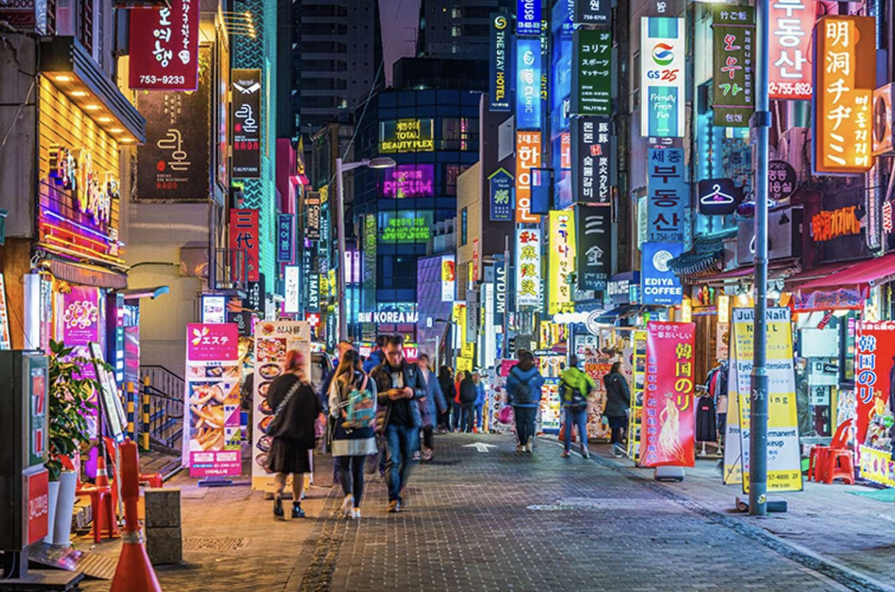
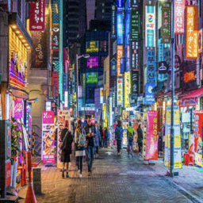

# AI Image Style Transfer

A deep learning project that applies artistic styles to photographs using Neural Style Transfer.

## Project Overview

This project uses a pretrained VGG19 neural network to combine the content of one image with the artistic style of another image.

The goal is to explore computer vision, image processing, and deep learning techniques.

## Technologies Used

- Python
- PyTorch
- Torchvision
- VGG19
- Pillow
- NumPy
- Matplotlib

## How It Works

1. Load a content image and a style image.
2. Extract image features using VGG19.
3. Calculate Content Loss and Style Loss.
4. Use a Gram Matrix to represent artistic style.
5. Optimize the generated image using Adam.
6. Apply Total Variation Loss to reduce visual noise.
7. Save the final stylized image.


## Experimental Results

We tested different optimization settings to study the balance between artistic style and image clarity.

| Experiment | Settings | Observation |
|---|---|---|
| Initial Transfer | 50 steps | Strong texture, noticeable noise |
| Longer Optimization | 200 steps | Lower loss, but noise remained |
| Content Preservation | Content weight = 10 | Better structural clarity |
| Noise Reduction | TV weight = 10 | Smoother image, weaker artistic texture |
| Balanced Result | TV weight = 2 | Good balance of clarity and color |

## Image Comparison

### Original Image



### Final Stylized Image



## Key Learnings

- Extracting visual features using a pretrained convolutional neural network.
- Understanding Content Loss and Style Loss.
- Using Gram Matrices for texture representation.
- Optimizing image pixels with gradient descent.
- Reducing visual noise with Total Variation regularization.


## Installation

1. Clone the repository:

```bash
git clone https://github.com/GizemSu/AI-Image-Style-Transfer.git
```

2. Navigate to the project folder:

```bash
cd AI-Image-Style-Transfer
```

3. Install the required libraries:

```bash
pip install -r requirements.txt
```

## Usage

1. Place your content image at `images/input.png`.
2. Place your style image at `images/style.png`.
3. Run the style transfer script:

```bash
python style_transfer.py
```

4. Find the generated image in the `images` folder.

## Future Improvements

- Support higher-resolution images.
- Add GPU acceleration.
- Experiment with different artistic styles.
- Build a simple user interface.

